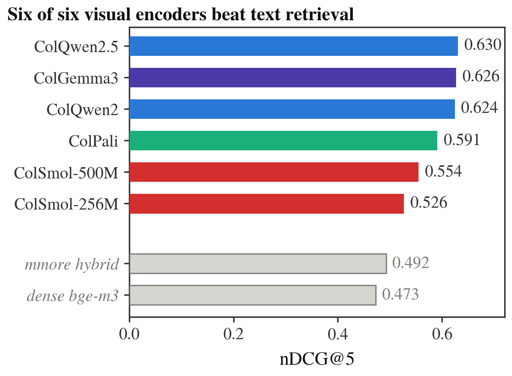
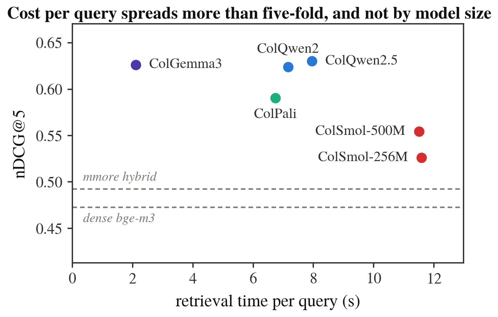
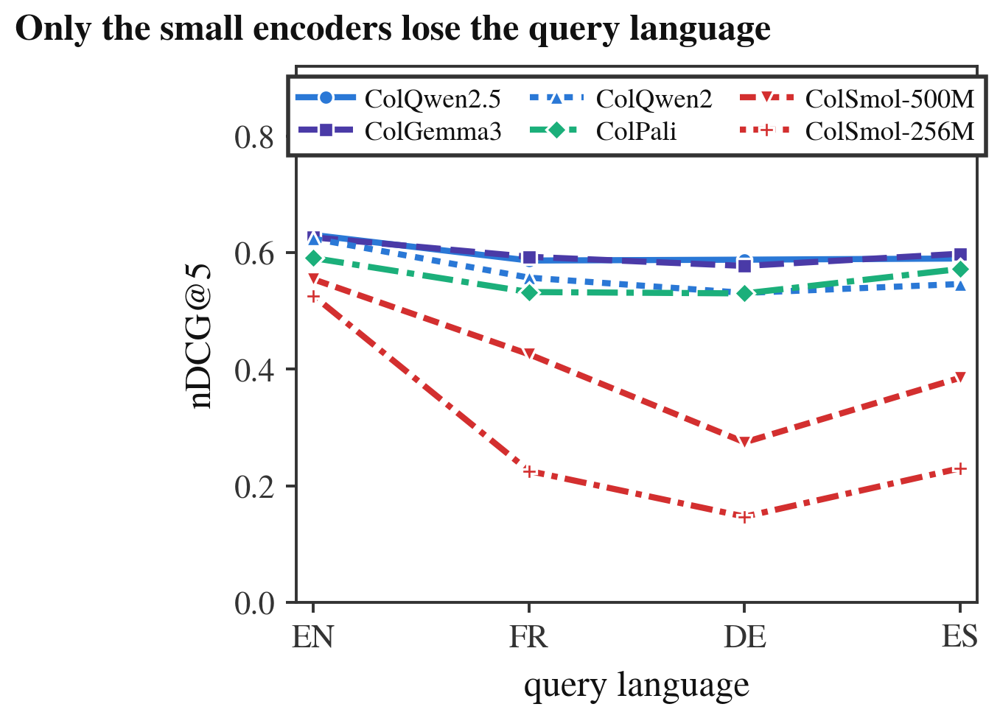
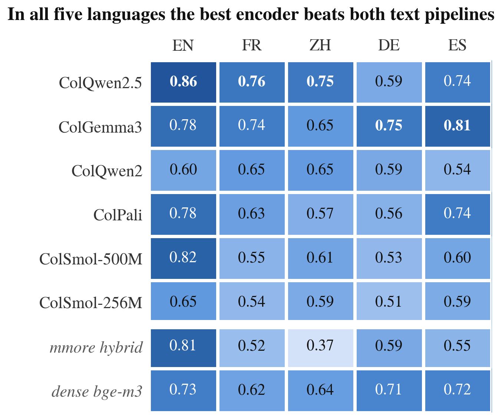

# Benchmarking ColVision retrieval models within the mmore RAG pipeline

> Mathieu Bonnet · Cassiopée research project, Télécom SudParis, supervised by Fabrice
> Nemo at EPFL LiGHT. Run on EPFL's RCP GPU cluster.
>
> 📄 **[Read the paper (PDF, 5 pages)](paper/benchmark-colvision.pdf)**

[mmore](https://github.com/swiss-ai/mmore), EPFL's multimodal RAG pipeline, retrieves a
page either from its extracted **text** or from its **image**, encoded by a ColPali-family
model. PR #305 brought that visual path from one encoder to six: ColPali, ColQwen2,
ColQwen2.5, ColGemma3, ColSmol-500M and ColSmol-256M. **Which one should you enable, and
what does it buy over the text path?**

Everything but the encoder and the corpus is frozen (index, reranker, `top_k=10`,
rendering, precision), and each run calls mmore's real CLI at a pinned commit: 54 runs
across two biomedical experiments.

**In short:**

- On figure-rich lecture slides, all six encoders beat the text path, the best by 28%
  (0.630 vs 0.492 nDCG@5). The top three are within 0.006, so **cost decides**, and it
  varies by 5.5× without following model size.
- On literature natively written in five languages, the best encoder stays ahead in every
  language, but **no encoder dominates everywhere**.
- mmore's hybrid text path is **not multilingually robust**: its English SPLADE stage
  degrades ranking outside English.

## Experiment 1: biomedical lecture slides

[ViDoRe v2](https://huggingface.co/datasets/vidore/biomedical_lectures_eng_v2): 1,016
figure-rich pages, 160 queries written with the page in view and validated by humans,
graded multi-page relevance.

<picture>
  <source media="(prefers-color-scheme: dark)" srcset="assets/retrieval_quality-dark.png">
  
</picture>

**Quality.** All six encoders beat mmore's text path: the best by 28%, ColSmol-256M by
only 7%. The order of the large encoders reproduces the public ViDoRe v2 leaderboard.

<details>
<summary>All metrics</summary>

<!-- generated:track-a-metrics -->
|  | nDCG@5 | nDCG@10 | MRR | Recall@10 | MAP@10 |
| --- | --- | --- | --- | --- | --- |
| ColQwen2.5 | **0.630** | **0.666** | 0.717 | 0.766 | **0.573** |
| ColGemma3 | 0.626 | 0.660 | 0.709 | **0.767** | 0.564 |
| ColQwen2 | 0.624 | 0.657 | **0.723** | 0.754 | 0.563 |
| ColPali | 0.591 | 0.627 | 0.683 | 0.719 | 0.536 |
| ColSmol-500M | 0.554 | 0.574 | 0.629 | 0.674 | 0.482 |
| ColSmol-256M | 0.526 | 0.556 | 0.615 | 0.661 | 0.457 |
| _dense bge-m3_ | 0.473 | 0.504 | 0.560 | 0.599 | 0.416 |
| _mmore hybrid_ | 0.492 | 0.521 | 0.562 | 0.625 | 0.433 |
<!-- /generated -->

</details>

<picture>
  <source media="(prefers-color-scheme: dark)" srcset="assets/retrieval_cost-dark.png">
  
</picture>

**Cost.** From 2.11 s/query (ColGemma3) to 11.59 s (ColSmol-256M). Cost broadly follows
the number of vectors per page that MaxSim iterates over, not the parameter count: the
smallest encoder is the slowest. ColGemma3 matches the leaders at a quarter of
ColQwen2.5's cost.

<picture>
  <source media="(prefers-color-scheme: dark)" srcset="assets/query_language-dark.png">
  
</picture>

**Query language.** The same queries in French, German and Spanish
([ViDoRe's official translations](https://huggingface.co/datasets/vidore/biomedical_lectures_v2)),
against the English index: the four large encoders lose at most 0.09 nDCG@5,
ColSmol-256M falls from 0.526 to 0.147.

## Experiment 2: native literature in five languages

PMC OA articles natively written in English, Chinese, German and Spanish, and HAL theses
for French: nothing is translated. 50 PDFs / 500 pages and 432 to 724 queries per
language. Queries are in English (retrieval is cross-lingual), generated by
Qwen2.5-32B-Instruct from the page **text**, which favours text retrievers: the visual
margin is a floor.

<picture>
  <source media="(prefers-color-scheme: dark)" srcset="assets/multilingual_heatmap-dark.png">
  
</picture>

<details>
<summary>Best encoder vs text pipelines</summary>

<!-- generated:multilingual -->
| corpus | best encoder | dense bge-m3 | mmore hybrid |
| --- | --- | --- | --- |
| English | ColQwen2.5 (0.860) | 0.734 | 0.812 |
| French | ColQwen2.5 (0.756) | 0.620 | 0.517 |
| Chinese | ColQwen2.5 (0.750) | 0.639 | 0.372 |
| German | ColGemma3 (0.749) | 0.714 | 0.594 |
| Spanish | ColGemma3 (0.807) | 0.721 | 0.551 |
<!-- /generated -->

</details>

- **No encoder dominates everywhere.** ColQwen2.5 leads in English, French and Chinese,
  ColGemma3 in German and Spanish, with a 0.158 gap between them in German.
- **Script is not the difficulty, German is.** Averaged over the six encoders, Chinese
  (0.637) is level with French (0.643); German is the hardest (0.590).
- **mmore's hybrid text path breaks outside English.** SPLADE helps in English (0.812 vs
  0.734 dense) and hurts elsewhere, sharply in Chinese (0.372 vs 0.639). Routing by
  detected language should help (untested).

Full per-model tables: [`results/SUMMARY.md`](results/SUMMARY.md).

## Which encoder to enable

| Context | Recommendation |
| --- | --- |
| Default: quality at the best cost | **ColGemma3** |
| Maximum quality, cost no object | **ColQwen2.5** |
| German or Spanish corpus | **ColGemma3** |
| English, French or Chinese corpus | **ColQwen2.5** |
| Non-English queries | avoid **ColSmol** |

ColPali is the hard one to recommend: weaker and slower than ColGemma3.

## How it was built

- **Fixed-pipeline harness** driving mmore's `process → index → retrieve` CLI and scoring
  each run into one JSON record (mmore commit, queryset and corpus hashes included).
- **Cluster execution on Kubernetes + Run:AI** (no SLURM), with four venvs whose
  dependencies conflict.
- **Corpus connectors** for PMC OA (language and visual-density filters), HAL and ViDoRe.
- **Query generation** with Qwen2.5-32B-Instruct on vLLM (guided JSON, few-shot).
- **Generated outputs only**: every table and figure is rebuilt from the records by a
  script; 120 tests.

Two results were retracted along the way, with old records kept in
[`results/_superseded/`](results/_superseded): a page-numbering off-by-one that made text
look 2–4× better than vision, and a silently truncated index that had put ColSmol below
the text baselines.

## Limitations

- Experiment 2 uses a single query generator, which shares its backbone with ColQwen2.5.
  Experiment 1's human-validated queries escape that bias, and ColQwen2.5 still leads there.
- One run per cell: the 0.006 nDCG@5 between the top three is not a ranking.
- Linear nDCG gain, not comparable with the ViDoRe leaderboard; MAP and Recall capped at 10.
- Cost is wall-clock on a shared GPU; latency and VRAM are not instrumented.
- The French corpus comes down to a few long theses, so it is not a clean language effect.

Details in the [paper](paper/benchmark-colvision.pdf) and in [`results/README.md`](results/README.md).

## Reproducing

**Tables and figures (CPU, a few minutes).** Python 3.11 and
[uv](https://docs.astral.sh/uv/). Everything above is rebuilt from the committed records:

```bash
./scripts/setup.sh                               # venv + pinned mmore
.venv/bin/python -m pytest tests -q
.venv/bin/python scripts/summarize_results.py    # results/SUMMARY.md + README tables
.venv/bin/python scripts/make_figures.py         # assets/*.png
```

<details>
<summary><b>The full benchmark (GPUs, EPFL RCP)</b></summary>

Prerequisites: EPFL VPN, `runai login`, `docker login registry.rcp.epfl.ch`, and
`export HF_TOKEN=...`. Each `submit.sh` action is one Run:AI job.

```bash
./scripts/rcp/setup.sh                    # build + push the image, write .rcp-env
./scripts/rcp/bootstrap-venv.sh --wait    # venvs on the scratch volume

# Experiment 1: ViDoRe v2 slides
./scripts/rcp/submit.sh corpus-vidore     # pages -> PDFs + graded qrels
./scripts/rcp/submit.sh ocr-vidore        # OCR for the text baselines
./scripts/rcp/submit.sh track-a           # the six encoders
./scripts/rcp/submit.sh baseline-vidore dense
./scripts/rcp/submit.sh baseline-vidore mmore
./scripts/rcp/submit.sh corpus-vidore-lang french       # also german, spanish
./scripts/rcp/submit.sh track-b-vidore <model> french

# Experiment 2: native literature, <lang> = en | zh | de | es
./scripts/rcp/submit.sh corpus-lang <lang> 150 0        # 150 articles, seed 0
./scripts/rcp/submit.sh corpus-fr 100 0                 # French, from HAL
python scripts/rcp/materialize_tb_lang.py <lang>        # in a pod: cap to 50 PDFs
./scripts/rcp/submit.sh gen-tb <lang> <manifest> <pdfs> <out.jsonl>
./scripts/rcp/submit.sh track-b           # every encoder x language
./scripts/rcp/submit.sh baseline B <lang>
```

`gen-tb` takes the manifest and PDF folder written by `materialize_tb_lang.py`. After each
ingestion, check that the index holds as many pages as the corpus: an interrupted, resumed
ingestion reports success on a partial index. Before re-running a cell, delete its Milvus
database, or `retrieve` hangs. Sampling is seeded and `bcv-corpus verify` re-hashes a
corpus against its manifest.

</details>
